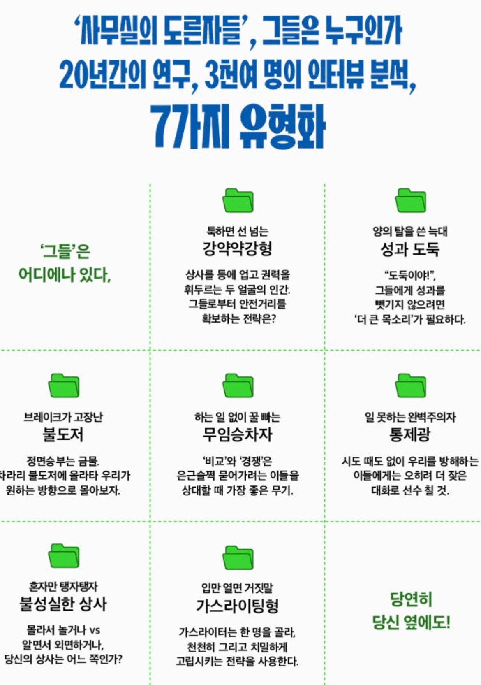

## 사무실의 도른자들

  
[알라딘 링크](https://aladin.kr/p/OQfqa)  
[테사 웨스트(Tessa West)](https://www.tessawestauthor.com/), 문학동네, 2022

### 짧은 소개

사무실에서, 직장에서, 일을 하며 만날 수 있는 악당 7가지 유형을 소개하고 그 대처방법을 알아보는 책이다.  
사무실을 전제로 했지만 학교, 사회, 군대 등 어디에서나 볼 수 있는 사람들 아닌가 싶다. 그냥 사람 사는 곳 everywhere..  
저자는 사회심리학 교수이고 장기간의 연구, 인터뷰 결과를 정리한 것이라 신뢰가 간다.  
대부분의 문제에 있어 해결 방법은 결국 내 편을 만들고 그들과 힘을 합쳐 문제를 해결하는 것이다.  
이걸 정말로 적용해서 원하는 결과를 얻을 수 있을지와는 별개로, 옛날 경험을 떠올리며 '아 그게 그런 거였어?!' 싶었던 순간이 많았다. 그리고.. 나도 누군가에게 저런 도른자였던 적이 있지 않았을까 하고 조금 반성도 했다.  

이런 분들에게 추천 : 상사 사용법을 알고 싶은 사람, 이상한 동료를 만나 괴로운 사람들, 직원 관리법, 앞으로 도른자가 되고 싶은 사람(매뉴얼이 되어 줄지도..)

### 정리

책에서 소개하는 도른자는 총 7가지다. 강약약강형, 성과 도둑형, 불도저형, 무임승차자형, 통제광형, 불성실형, 가스라이팅형이 그것이다. 각 장은 대략 이런 내용들로 구성되어 있다.

* 이해하기 쉬운 사례
* 그 유형의 특징
* 그들의 동기와 동력
* 목표물 고르는 방법
* 보이지 않는 이해관계
* 해결 또는 대처 방법

중간 중간 정리가 있어 쉽게 읽을 수 있다.

## 감상

조직 생활, 사회 생활에서 배울 점이 많은 책이었다.  
개인의 기여(또는 성과)를 정확히 짚고 넘어가라는 점은 조금 조심스럽다. 우리나라와 미국의 문화적인 차이일 수 있겠지만 나는 팀/조직을 좀 더 강조하는 편이다.  
내가 하는 일의 상당 부분 '교육생 팀 관리'인데 적용해볼 수 있는 아이디어들도 많이 있어서 직무에도 도움이 될 것 같다. '도른자 테스트'는 꼭 해봐야지.
