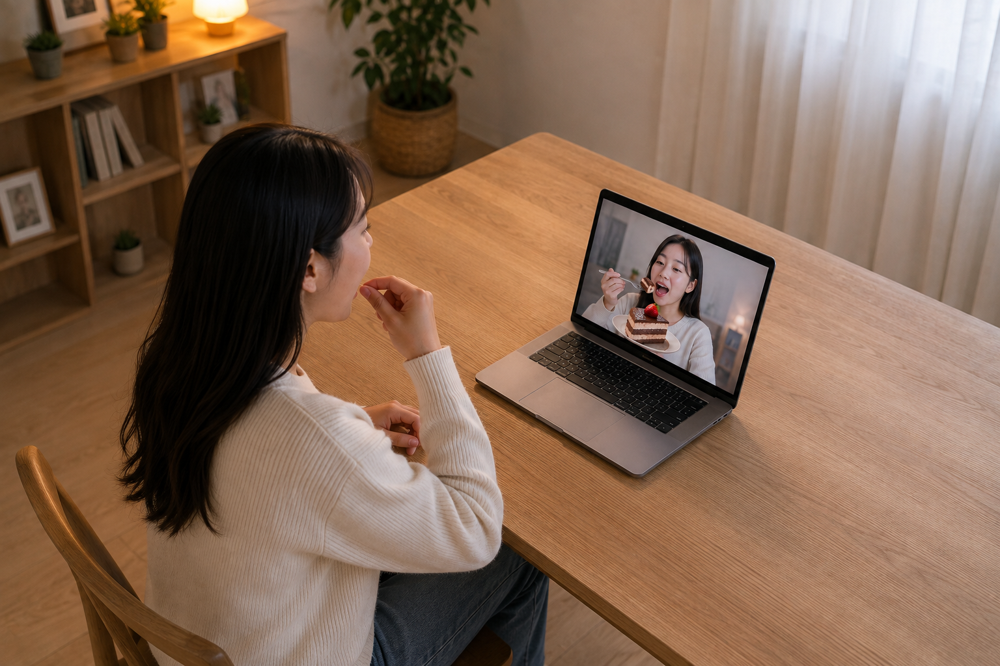

이곳에서는 6개월마다 새로운 교육생을 만나게 된다. 그래서 세대 변화가 좀 더 빠르게 느껴지는 것 같다. 이런 점이 다르다 하고 콕 집어 말하긴 힘들다. 하지만 달라지는 것은 느껴진다. 이번에는 세 가지가 눈에 띈다. 콜 포비아, 짭배민 같은 가짜 앱 그리고 말랑이와 키캡 키링이다.

## 세 가지 현상

## 콜 포비아

달라지는 것 중에는 팀의 프로젝트 주제도 있다. 한 팀이 콜 포비아 극복을 프로젝트 주제로 정했다. 콜 포비아 라는 게 있다고는 알고 있었다. 주변에서 신입 직원이 전화하는 것을 어려워한다는 얘기를 몇 번 듣기도 했다. 이번에는 교육생들 자신의 이야기다. 평소 자주 연락하는 사람이 아니면 전화받는 것을 꺼린다고 한다. 걸려오는 전화 말고도 용건이 있어 전화를 거는 것도 어려워한다는 것이다. 대단한 것도 아니다. 병원 예약을 해야 한다거나 통신사, 은행 등에 간단한 문의 전화를 하는 것이다. 되도록 통화하는 상황은 피하려고 한다고 말한다. 피치 못해 통화를 할 때에는 어떤 말을 할지, 어떤 상황에서 어떻게 대답할지 연습이나 계획을 세운다고 한다.

그 이유는 크게 두 가지를 얘기한다. 비동기 방식의 소통에 익숙한 것과 목소리만 들을 수 있는 전화라는 매체의 특징이다. 그들에게는 메신저, 소셜, 이메일과 같은 비동기 소통이 기본이다. 연락받고, 생각한 다음에, 원할 때 답을 할 수 있는 것이다. 전화는 반대로 동기 방식의 소통이다. 답을 빨리 해야 하며 수정할 기회를 주지 않는다. 목소리만 들을 수 있다는 점도 답답하다고 한다. 상대방의 표정을 볼 수도 없고 오로지 목소리와 내용만으로 어떤 상황인지 추정해야 한다는 것이다.

## 가짜 앱

또 다른 특이한 프로젝트 아이디어가 있었다. 다이어트를 하거나 음식 욕구를 대체하기 위해 셀카를 켜고 가상의 음식을 먹는 앱을 생각해 왔다. 노트북이나 스마트폰의 카메라를 켜면 나의 모습이 나오고 거기에 음식 이미지를 합성하는 것이다. 그리고 내가 먹는 동작을 하면 인터랙션이 생기고 화면 속의 내가 음식을 먹는 것 같은 모습을 보여준다고 한다. 설명이 힘들어 그림으로 그려봤다.

요새 유행하는 짭배민이라는 앱에서 착안했다고 한다. 짭배민이 뭔지 설명을 들어보니 음식 주문과 배달을 가짜로 하는 것이란다. 진짜 배민처럼 이동하는 것도 보여준다고 한다. 이와 함께 담타(담배 타입)앱 이라는 것도 유행한다고 한다. 역시 담배를 피우는 건 아니고 화면상의 담배가 타들어가는 걸 보면서 이런저런 얘기를 하는 것이라고 한다.

## 말랑이와 키캡 키링

가방에 다는 인형이나 책상을 꾸미는 작은 인형 같은 소품들 그리고 유행하는 장난감 등을 쉽게 볼 수 있다. 처음 보는 물건이 있으면 관심이 생겨 뭔지 물어보기도 한다. 이번에는 손안에 들어오는 크기의 오렌지색 물건(?)이었다. 말랑이란다. 스트레스를 받거나 하면 이걸(말랑이) 조물조물 만지며 긴장을 푼다고 한다. 말랑이와 비슷한 슬랑이 라는 것도 있고, 왁뿌볼 이라는 것도 유행이라며 얘기해줬다. 듣고 나서 강의실을 돌아보니 말랑이가 여기저기 눈에 띈다.

또 다른 액세서리로는 키캡 키링이 있다. 처음 본지는 꽤 됐는데 요새는 확실히 유행 중인 것 같다. 마찬가지로 긴장하거나 하면 키캡을 누르며 스트레스를 푼다고 한다. 이런 피젯 토이류를 처음 본 건 한 10년 전쯤 회사 후배에게서였다.

내가 보기에는 피드백 부족 또는 감각 공백을 해소하기 위해서 하는 것 같다. 자극과 반응이 없는 상황을 못 참아서 그러는 걸까? 나에게는 이런 피젯 토이류를 가지고 노는 모습이 스마트폰 화면을 정신없이 스크롤하고 스와이프하는 모습과 겹쳐 보인다.

## 불안 세대로 본 이 세대의 특징

이 모든 것에 대한 나의 첫 반응은 '애들이 왜 이러지'였다. 10여 년 전에 피젯 토이를 처음 봤을 때도 그랬다. 그 후배가 뭔가 별난 점이 있다면 그러려니 했을 것이다. 하지만 오히려 멀쩡한 친구였다. 이번에 콜 포비아 아이디어를 주로 얘기한 교육생도 그렇다. 소심하고 말주변이 없는 친구라면 그러려니 했을 수도 있을 것이다. 전혀 아니다. 실제로는 수다스럽고 다른 친구들하고도 아주 잘 지낸다. 그런데 전화로 얘기하는 것은 힘들다는 것이다. 다른 사례도 비슷하다. 가상 음식 앱을 낸 교육생도, 말랑이를 주물거리는 교육생도, 키캡을 딸깍이는 교육생도 모두 멀쩡하다.

이것들의 용도로 많이 얘기하는 것은 스트레스 해소, 긴장 완화, 욕구 대체 같은 게 있다. 과연 그런 효과가 있는지는 차치하더라도, 그것을 유발하게 하는 근본적인 문제 해결에는 큰 도움이 안 될 것 같다. 오히려 의존증이 생기거나 집중력 저하만 가져올 것 같다. 기성 세대 시각으로는 `그냥 맞부딪히면 될 것을` 이라고 생각하기 쉽다.

가볍게 생각한다면 그냥 유행하는 장난감 정도 일것이다. 반면 진지한 현상으로서 보면 스트레스 상황을 회피하려는 것 같기도 하다. 다른 말로 하면 현실에서 생기는 마찰과 긴장을 잘 받아들이지 못하는 것이다. 콜 포비아에서는 정보 부족을 견디지 못하고, 가짜 앱을 통해서는 욕구 불만을 견디지 못하고, 말랑이와 키캡 키링에서는 감각 공백을 견디지 못하는 것 같이 느껴진다. 이런 특징은 어릴 때부터 스크린 위의 대체 경험에 익숙해져서 생긴 것은 아닐까?

관련된 문제를 지적하는 [불안 세대](https://aladin.kr/p/0qFmn) 라는 책을 읽어봤다. 제목에 나와 있듯이 현재 청년~청소년 세대의 불안 문제를 다루고 있다. 책에서는 (현실) 놀이 기반 아동기에서 스마트폰 기반 아동기로 전환을 주요 원인으로 짚고 있다. 다른 말로 하면 현실에서의 위험으로부터는 과도하게 보호했고, 인터넷(소셜 미디어 등)의 위험으로부터는 보호하지 못한 결과라는 것이다. 또한 코로나와 같은 특수한 상황을 성장기에 겪은 것도 지적하고 있다.

책에서 제시하는 근거와 자료는 꽤 납득이 갔다. 해결 방안도 현실적이라고 생각한다. 여러 나라에서 청소년의 소셜 미디어 사용을 제한하는 등 일부 현실화되고 있는 모습도 보인다.

## 결론

그들이 잘못됐다고 지적하는 것은 아니다. 청년 세대의 성장 환경을 만든 것은 어른들이니까. 기성 세대의 입장에서, 현재를 기준으로 생각해 보면 이들 세대의 청소년기가 늘어난 것 같다. 현실 세계에서의 경험이 기존 세대에 비해 부족한 것이다.

희망적인 것은 콜 포비아 극복 프로젝트 처럼 그들 자신이 문제를 인식하고 있으며 이를 고치려 한다는 점이다. 그래서 프로젝트도 그에 맞게 설계했다. 처음에는 익숙한 환경(화상 통화처럼 가상의 상대방이 보인다거나)에서 안전함을 느낄 수 있게 시작하고 차츰 단계를 높여 최종적으로는 어떠한 정보도 제공해 주지 않고 랜덤한 상대방과 음성 통화만 하도록 했다. 콜 포비아가 있는 신입사원을 받은 기성 세대는 어떻게 하면 좋을까? 전화 공포를 벗어날 수 있게, 전화 경험이 더 이상 무섭지 않도록 곁에서 도와주면 좋겠다.

다만 이 모든 것은 하나의 전제가 뒷받침되어야 한다. 앞으로의 세상이 이전과 같다면. AI 기술이 더 퍼지게 되면 키오스크처럼 더 많은 것들이 비대면화될 것이기 때문이다. 전화 통화조차도 AI 에이전트가 대신하게 되지 않을까? 어쩌면 그들의 행동이 새로운 기준이 될 수도 있다.